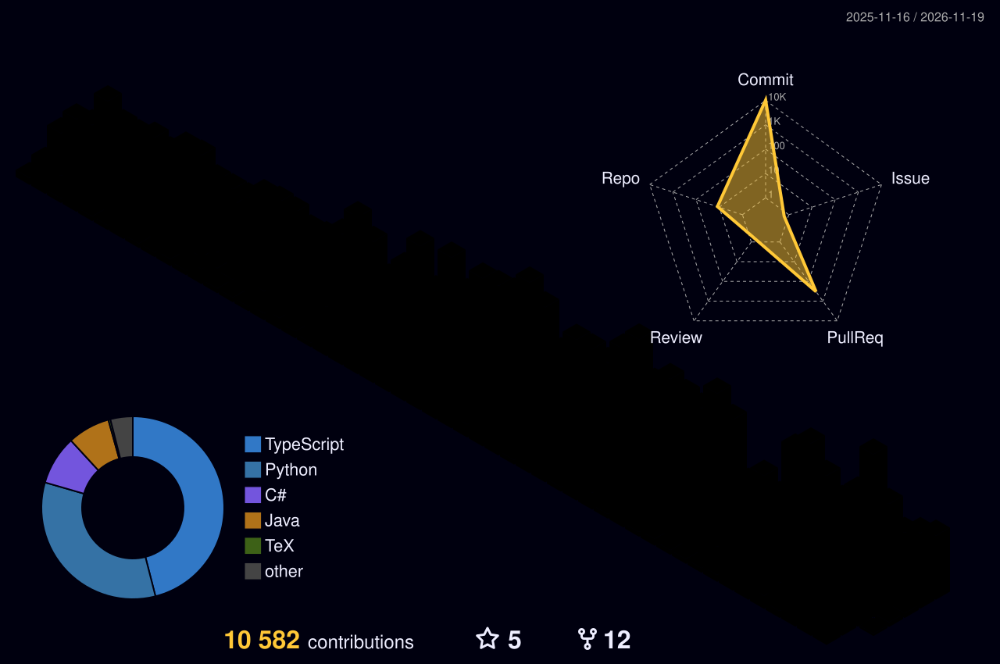

  

## 👋 CHOI SI-HUN

**(주)디알밸류 · TD(Technical Director) · M.S. Student (Smart Construction Engineering, Hanyang Univ.)**

- 📧 Email: sh.choi@drvalue.co.kr

**Highlights**
- 🏭 제조 SaaS 백엔드: PCB MES·ERP를 멀티테넌트 SaaS로 설계·개발 (스키마 기반 멀티테넌시 직접 설계)
- 🔐 통합 인증(IAM): 게이트웨이, 토큰 회전·재사용 탐지, IP 차단, 인프라 운영 콘솔
- 🤖 LLM 서비스: 근거 인용 RAG 채팅, 자체 GPU 서버의 업무 AI 모델 (vLLM · Qwen)
- 🧠 Research: UAV 균열 초해상도, 영상 기반 균열 성장 예보 (Computer Vision)

---

<b>💻 Experience</b> (click)

* **(주)디알밸류 · BE Developer → TD** <!-- TODO: 입사 연월 확인 (2024.02?) --> ~ Present
   * **EMMA** · PCB 제조사용 멀티테넌트 SaaS ERP/MES · 프로젝트 PL
     * 작업지시·생산, 원가·견적, 불량/납기 예측, 구 ERP 이관 도구
   * **Bori** · EMMA 내장 PCB 업무 AI 모델 (자체 GPU 서버, vLLM · Qwen)
   * **drvalue IAM** · 통합 인증·인가 서버, 게이트웨이, 인프라 운영 콘솔 · 프로젝트 PL
   * **CutON** · 판금 견적·전개 제품 · 프로젝트 PL
     * STEP/DXF 평판 전개 엔진, AutoCAD 플러그인, 웹 견적 플랫폼
   * **한건(Hangun)** · 건설 기준·법령 근거 인용 RAG 채팅 서비스 · 프로젝트 PL <!-- TODO: 마지막 커밋 2026-09, 진행 중인지 확인 -->
   * **GPN SCM 통합** · 구 ERP(MSSQL)·SCM 2종을 하나의 웹 SCM으로 통합
   * **GrowXD PCB MES** · 기존 PCB MES·ERP, 스키마 기반 멀티테넌시 설계 · 프로젝트 PL
   * **엠슈머 제조 매칭 플랫폼** · 백엔드 초기 개발 → PL
   * 화장품 MES 등 사내 MES 부하 테스트 (k6, 500 VU)
* **(주)싱귤래리티 · BE Developer** (2024.02 ~ 2025.02) <!-- TODO: 기간 확인 -->
   * Chatnote(대학생 AI 공부 필기앱) · 백엔드 초기 개발
   * 예비창업패키지 선정
* **(주)신성아이씨티 · BE Developer** (2024.02 ~ 2024.09) <!-- TODO: 볼트 자료는 2023-08 ~ 2024-08, 기간 확인 -->
   * MCC 원모바일 · 백엔드 초기 개발/유지보수
   * 에이트리인베스트먼트 · 백엔드 초기 개발
   * 무비보드 · 댓글 통합 분석 솔루션 개발/유지보수
   * 조리실 오염 부유물질 측정 및 AI&빅데이터 관제 시스템(국가R&D) · 백엔드 개발/유지보수

<b>📄 Research</b> (click)

* **Domain-Adaptive Super-Resolution for UAV-Based Structural Crack Quantification** · 2nd author · Under revision
   * ArUco 정합으로 근거리·원거리 UAV 촬영 쌍 구축, 현장 열화 추정 기반 균열 특화 SR → 균열 폭 측정 정확도 개선
* **영상 기반 콘크리트 균열 성장 예보 (점검 주기 결정)** · 1st author · In preparation (Automation in Construction)
   * 점검 사진 두 장으로 균열 성장 위치를 예보하고 점검 주기를 단축·유지·연장으로 결정

<b>🏆 Awards</b> (click)

* 2023 대한민국 SW 융합 해커톤 우수상(2위) (세종특별자치시장상)
* 2023 KCC2023 학부생/주니어 논문 경진대회 논문 등재 (Privacy Guard)
* 2023 한양대 ERICA 창업/아이디어톤 다수 수상 (최우수/우수/SID상 등)

<b>🎓 Education</b> (click)

* 한양대학교 스마트컨스트럭션공학과 석사과정 (2026.03 ~) <!-- TODO: 입학월 확인 -->
* 한양대학교 ERICA 스마트융합공학부 스마트ICT융합전공 학사 (~ 2026.07)

---

## 🛠 Tech Stack

**Backend**: TypeScript, Node.js, NestJS, Java, Spring Boot, Python, FastAPI
**ORM/Queue**: TypeORM, Prisma, BullMQ, RabbitMQ
**DB**: PostgreSQL, MySQL/MariaDB, SQL Server, Redis, Elasticsearch, pgvector
**Infra**: Docker, k3s, Helm, NGINX, Traefik, GitHub Actions
**AI/LLM**: vLLM, LiteLLM, Qwen, OpenAI · Claude API
**Research**: PyTorch, OpenCV

---

## 📈 GitHub Stats

